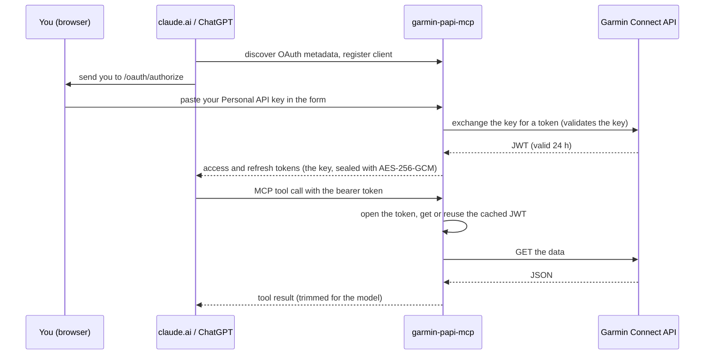

# garmin-papi-mcp

A read-only [MCP](https://modelcontextprotocol.io) server for the Garmin Connect Personal API, with an OAuth 2.1 login form. It lets claude.ai, ChatGPT and other MCP clients read **your own** Garmin Connect data (sleep, heart rate, HRV, activities, weight, and so on) without custom headers: you paste your Personal API key into a form once, and the server turns it into OAuth tokens for the client.

A public instance is hosted by its author at `https://garmin-papi-mcp.zigmund.xyz` (MCP URL `https://garmin-papi-mcp.zigmund.xyz/mcp`). You can also run your own.

> **Read this first.** This project is **not affiliated with, endorsed by or supported by Garmin**. Garmin's Personal API key program is intended for individuals accessing their own data. Giving your key to a third-party server (this one, or any other instance) is your decision and your responsibility: check Garmin's terms before you do. The server is strictly read-only; it cannot change anything in your Garmin account. If you are not comfortable trusting an operator with your key, run your own instance.

## How it works



There is no database. The key lives only inside the sealed tokens; the client stores them and cannot decrypt them. Server-side state is in memory and lost on restart: single-use replay caches, rate limiters and a cache of Garmin JWTs keyed by a hash of the key.

### Who sees what

| | Your Personal API key | Your Garmin data | Your OAuth tokens |
| --- | --- | --- | --- |
| **You** | yes (you create it) | yes | no |
| **claude.ai / ChatGPT** | no (they get a sealed token, which they cannot read) | yes, the tool results you ask for | yes, stored and sent with each call |
| **This server** | yes, in memory while handling a request (typed into the form, or opened from a token); never stored, never logged | yes, in transit only; never stored or logged | yes, it issues and opens them |
| **Garmin** | yes (used to authenticate) | yes (it is the source) | no |

A TLS-terminating reverse proxy in front of the server also sees the key in the form submission (and bearer tokens on every call). If you run your own instance, you are that operator.

## Tools

All 17 tools are read-only. Dates are `YYYY-MM-DD` in your own Garmin time zone. Large series (heart rate, stress, Body Battery, HRV, SpO2) are downsampled by default to keep answers small.

| Tool | What it returns |
| --- | --- |
| `get_profile` | Profile settings (units, time zone, preferences) and heart rate zones |
| `get_daily_summary` | Daily summary (steps, calories, distance, and more) for a date or a range |
| `get_sleep` | Sleep data for a date or a range |
| `get_heart_rate` | Heart rate for one date |
| `get_hrv` | Heart rate variability for a date or a range |
| `get_body_battery` | Body Battery for a date range |
| `get_stress` | Stress levels for a date range |
| `get_steps` | Daily steps for a date range |
| `get_spo2` | Pulse oximetry (SpO2) for one date |
| `list_activities` | Recorded activities with filters, trimmed summaries |
| `get_activity` | Full details of one activity and its workouts |
| `get_weight` | Weight and body composition entries plus the weight goal for a range |
| `get_nutrition` | Food log for one date |
| `get_hydration` | Hydration for a date range |
| `get_fitness_age` | Fitness age and its factors for one date |
| `get_wellness_activities` | Wellness activity summaries for a date range |
| `get_menstrual_cycle` | Menstrual cycle summary and day view for one date (many accounts have none) |

An empty result is reported as "no data for this period", not as an error. A Garmin rate limit is reported as a distinct tool error.

## Get a Personal API key

1. Sign in to Garmin Connect on the website.
2. Open the Personal API Key page described at <https://developer.garmin.com/gc-developer-program/personal/personal-api> and create a key. You choose its expiry.
3. Keep it secret: it grants read access to your data. Revoke it there at any time.

## Connect from claude.ai or ChatGPT

1. Add a custom connector (claude.ai: Settings -> Connectors -> Add custom connector; ChatGPT: Settings -> Connectors -> add a custom MCP connector).
2. Enter the MCP URL: `<public_url>/mcp`, for example `https://garmin-papi-mcp.zigmund.xyz/mcp`.
3. When the client sends you to the login page, read it, paste your Personal API key, choose how long to stay connected, accept the terms if the operator set any, and press Authorize.

If Garmin rejects the key (expired or revoked), the form shows an error. When a key stops working later, the server answers 401 and the client asks you to log in again.

## Run your own

Requirements: a Linux host with systemd, a DNS name, a TLS-terminating reverse proxy (for example nginx) in front of `127.0.0.1:8788`, or the built-in TLS (`tls.*`).

```sh
# 1. Install the binary (from a release archive, or `make build`).
install -m 0755 garmin-papi-mcp /usr/local/bin/garmin-papi-mcp

# 2. Config and token encryption key (root-only; the unit hands a private copy to the service).
install -d -m 0755 /etc/garmin-papi-mcp
install -m 0644 deploy/config.example.yaml /etc/garmin-papi-mcp/config.yaml   # edit public_url first
install -m 0600 -o root -g root /dev/null /etc/garmin-papi-mcp/keys
openssl rand -base64 32 > /etc/garmin-papi-mcp/keys

# 3. Install and start the unit.
install -m 0644 deploy/garmin-papi-mcp.service /etc/systemd/system/
systemctl daemon-reload
systemctl enable --now garmin-papi-mcp
curl -fsS http://127.0.0.1:8788/healthz
```

Every config key is described in [docs/configuration.md](docs/configuration.md); the design is in [docs/architecture.md](docs/architecture.md). Because the unit uses `DynamicUser=` and `LoadCredential=`, the config file holds only the path `/run/credentials/garmin-papi-mcp.service/keys`, never key material. To rotate the token key, add a new key as the first line (the older ones still decrypt) and reload. Replacing every key signs everyone out.

Optional: write your own terms of use (see `deploy/terms.example.txt`, which is an example and not legal advice) and set `oauth.page.terms_file`, `oauth.page.contact` and `oauth.page.notice`.

## Privacy and security

- **The key is sealed into the tokens.** It is AES-256-GCM encrypted with the operator's token key and carried in the access and refresh tokens. It is never stored on the server and never logged. Logs carry metadata only (tool name, status, duration, client IP); never tokens, keys, Garmin JWTs, request or response bodies, or query strings.
- **Tokens are bearer secrets and are not revoked.** Whoever holds a token can read your data until it expires. Disconnecting in the client does not invalidate it server-side (there is no database). To cut access immediately, revoke the Personal API key at Garmin (the next call then fails and the token is useless), or have the operator rotate the token key.
- **Session length.** Access tokens last 1 h; refresh tokens 720 h idle; an absolute session limit of 90 days by default (`oauth.max_session_ttl`). The login form can let you choose a shorter or longer session (`oauth.session_choices`). All configurable by the operator.
- **Garmin JWT.** The server exchanges your key for a Garmin JWT (valid 24 h) lazily and caches it in memory only, keyed by a hash of the key, until shortly before it expires. A restart drops the cache.
- **TLS proxy.** A reverse proxy that terminates TLS sees the key in the form submission and the bearer tokens. Only use an operator you trust.
- **Rate limits.** Every Garmin call leaves from the server's IP, so the server limits requests per IP on the OAuth endpoints, per IP (unauthenticated and invalid requests only) and per token on the MCP endpoint, caps concurrency per token and in flight, and caps the request body. Defaults are in [docs/configuration.md](docs/configuration.md).
- **Redirect URIs are allow-listed** (claude.ai, claude.com, ChatGPT by default). Authorization uses PKCE S256, dynamic client registration and single-use codes and refresh tokens.
- **Read-only.** Every tool is annotated read-only and only issues GET requests to Garmin.
- **Hygiene.** This repository contains no real keys, tokens or user data; CI scans for secrets with gitleaks and blocks credentials and local agent files from being tracked.

## Testing

`make test` runs everything offline: unit tests plus `internal/e2e`, which drives the full OAuth flow and all 17 tools over HTTP against a fake Garmin and checks tool output sizes and range limits. It never touches the network or `test/api.key`.

Live tests against Garmin are opt-in. With your own Personal API key in `test/api.key` (git-ignored; override the path with `GARMIN_API_KEY_FILE`):

```sh
make live-test   # GARMIN_LIVE=1 go test ./internal/e2e/ -run Live -v
```

It calls every tool against the real API and prints only the tool name, an outcome (ok, no-data, tool-error) and the result size, never payloads, keys or tokens. Without `GARMIN_LIVE=1` or the key file it skips.

## Development

```sh
make build   # bin/garmin-papi-mcp
make test    # go test -race ./...
make vet
```

Releases: [docs/releasing.md](docs/releasing.md). License: see [LICENSE](LICENSE).
